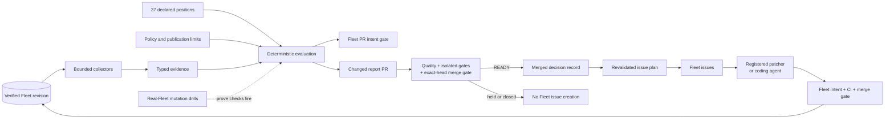

# Infra Fleet Advisor

Infra Fleet Advisor continuously compares the verified desired state of
[`infra-fleet-public`](https://github.com/ImranAdan/infra-fleet-public) with its
declared security, reliability, cost, and maintainability intent. It produces
evidence-backed recommendations and moves reversible work through deterministic
quality, intent, and merge gates.

[Documentation](docs/README.md) · [End-to-end workflow](docs/WORKFLOW.md) ·
[Local setup](docs/setup.md) · [Contributing](CONTRIBUTING.md) ·
[Security](SECURITY.md)

## System model



The advisor is the policy and evidence boundary, not a general-purpose agent.
Deterministic code verifies the source revision, selects collectors, validates
evidence, evaluates declared checks, constrains any model output, and decides
what may be published.

## End-to-end flow

1. **Guard a Fleet change.** Every Fleet PR runs the pinned intent gate. A
   change fails when it introduces a declared divergence or removes decisive
   evidence from a position that was previously proved.
2. **Review merged state.** The scheduled advisor workflow checks a verified
   Fleet commit. It opens or updates a report PR only when the material report
   changes.
3. **Record the decision.** Generated report PRs opt into exact-head autonomous
   merge. `Advisor Quality`, the isolated `Advisor Gates` job, and the merge
   gate must all pass. Removing the opt-in marker holds the report; closing it
   declines that material signature. Neither path creates Fleet issues.
4. **Create actionable work.** After a report merges, a separate publisher
   revalidates the approved report, current policy, intent digest, and bounded
   issue plan. Eligible recommendations become deduplicated issues in the Fleet
   repository, each linked to its report decision record.
5. **Propose fixes.** Registered mechanical findings can become opted-in Fleet
   PRs through an artifact-separated, Fleet-owned write job. Other issues wait
   for a coding agent. Every proposal still passes Fleet CI, the intent gate,
   and the merge gate.
6. **Measure the result.** The next review reuses finding identity, records
   resolved evidence, and proposes a new report only when the approved state
   changes.

Incomplete evidence remains visible as coverage. It does not become a finding,
an issue, or proof that the Fleet is healthy. See [the workflow](docs/WORKFLOW.md)
for retries, holds, feedback, and remediation details.

## Run a local review

Requires Git, Python 3.11+, `uv`, and Make. Clone the repositories beside one
another:

```bash
git clone https://github.com/ImranAdan/infra-fleet-public.git
git clone https://github.com/ImranAdan/infra-fleet-advisor-public.git
cd infra-fleet-advisor-public

make setup
make review
```

Open `review-output/report.md`. The default `stub` synthesizer is deterministic
and makes no model API call. The Fleet checkout must be clean, and the review
leaves it unchanged. Local output is diagnostic; only a merged, exact-head
report becomes the approved baseline.

Run the complete local quality suite before changing advisor behavior:

```bash
make check
```

See [local setup](docs/setup.md) for custom source paths and troubleshooting.

## What is evaluated

The current catalog contains **37 declared positions**, all with registered
checks:

| Domain | Coverage |
|---|---|
| Security | workflow credentials, workload identity and hardening, network ingress and egress, external transport, EKS endpoint exposure, IAM scope, CSRF, service-account tokens, dependency security updates, image scanning, repository security settings, branch protection, broker ingress, and Pod Security on application namespaces |
| Reliability | rollout capacity during updates, self-recovering HelmReleases, canary rollback, the messaging contract, and surviving node drains on AWS |
| Cost | idle staging capacity, worker bounds, log retention, image lifecycle, cost-allocation tags, the local footprint budget, and metrics retention |
| Maintainability | profile lifecycle, local first use, AWS onboarding and teardown, swappable applications, risk-aware autonomous merges, agent completion rules, documentation link health, DORA coverage of every app, and no dead platform manifests |

Twenty-one checks can prove their positions satisfied from complete repository or
prefetched settings evidence. The remaining sixteen are divergence-only: clean
desired state cannot prove live behavior, external configuration, or an agent's
future conduct. The report labels those positions `declared_unverified` rather
than converting absence of a detected problem into a pass.

The Kubernetes collectors evaluate the resources each deployment profile
actually composes, including Flux substitutions used by the application
contract. Terraform, workflows, application configuration, repository settings,
documentation links, lifecycle scripts, and agent rules use separate bounded
collectors. A platform collector reads operability from the same renders:
release recovery, canaries, disruption budgets, Pod Security, footprint,
retention, manifest reachability, messaging contracts and DORA coverage. Exact support and limitations are maintained in [scope and
coverage](docs/status.md).

## Evidence and safety boundaries

- Reviews operate on a clean checkout bound to a full Git commit.
- Repository text, scanner output, prior reports, and model output are untrusted
  inputs; none may change policy, enable tools, or relax publication gates.
- Every recommendation cites validated, repository-relative evidence and
  includes impact, a suggested change, trade-offs, confidence, and a stable
  fingerprint.
- Every registered check has a mutation drill against the real Fleet. The
  ratchet compares base and proposed advisor behavior on the same Fleet commit.
- Review is read-only. Issue publication uses a separate issues-only identity;
  remediation planning is read-only, and only the Fleet-owned job may write a
  proposed Fleet branch.
- A successful merge decision never overrides declared intent. The Fleet intent
  gate remains required for every proposed fix.

## Repository map

```text
intent/                          Declared positions by policy domain
policy.yaml                     Priorities, limits and delivery policy
src/infra_fleet_advisor/
  core/                         Immutable evidence, report and pipeline contracts
  config/                       Closed policy and intent loading
  provenance/                   Source and run identity
  runtime/                      CLI composition, validation and publication
  scenarios/fleet_repository_review/
                                 Collectors, checks and synthesis inputs
drills/fleet-mutations.yaml      One real-Fleet mutation per registered check
reports/                        Approved report baseline and rendered report
tests/                          Deterministic unit, integration and workflow tests
docs/                           User guides, specifications and decision records
.github/workflows/              Review, gate, publish and feedback automation
```

## Guides

| Task | Guide |
|---|---|
| Run the complete report-to-Fleet process | [End-to-end workflow](docs/WORKFLOW.md) |
| Configure and run a review | [Local setup](docs/setup.md) |
| Declare or revise a position | [Intent guide](docs/intent.md) |
| Add a deterministic check and drill | [Add a check](docs/adding-a-check.md) |
| Review, hold, or retry report delivery | [Report guide](docs/reports.md) |
| Configure Fleet issue creation | [Fleet publication](docs/fleet-publication.md) |
| Understand implemented and unsupported evidence | [Scope and coverage](docs/status.md) |
| Understand internal boundaries | [Architecture](docs/architecture.md) |

Optional decision feedback, mechanical remediation, specifications, and product
decision records are listed in the [documentation index](docs/README.md).

## License

[MIT](LICENSE)
